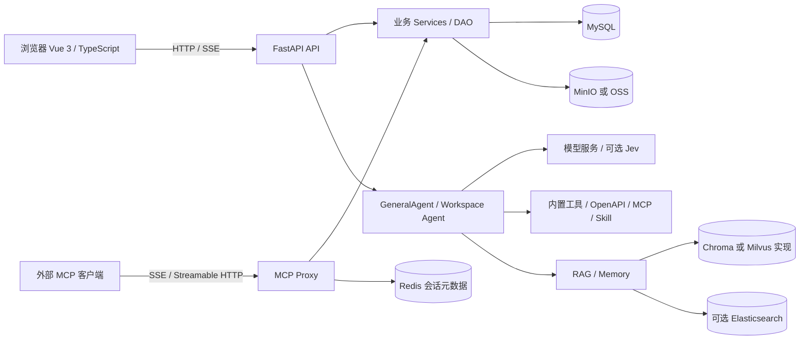

# 当前系统架构

更新日期：2026-10-27。依据：已提交的应用源码及既有验证记录；架构基线最初于 2026-10-21 静态整理。应用 `08f9b23` 已部署，后续 `5d67cc7` 仅更新运维文档，应用和部署文件无差异。具体运行证据与限制见[验证报告](verification-report.md)，逻辑架构图不代表所有路径已经验收。

## 系统边界

AgentRuler 是一个前后端分离的应用：Vue 单页前端调用 FastAPI 后端，后端在同一 Python 工程中组织业务服务、Agent、RAG、MCP 代理和数据库访问。Docker Compose 将应用与依赖服务组合部署；现有代码不足以证明业务已拆成独立微服务或具备高可用能力。

图中表示逻辑依赖，未表示独立进程数、网络隔离或已验证的容灾拓扑。

## 模块与依赖方向

| 路径 | 当前职责 |
|---|---|
| `src/frontend/src/pages`、`components` | 工作台、会话、Agent、模型、工具、MCP、知识库、Skill、统计等界面 |
| `src/frontend/src/apis`、`utils/request.ts` | HTTP 请求与 SSE 接入；普通请求从 localStorage 读取 token 并发送 Bearer 头 |
| `agentruler/main.py`、`settings.py` | FastAPI 生命周期、中间件、配置装载 |
| `agentruler/api/v1` | `/api/v1` 业务路由、请求解析、依赖注入及流式响应入口 |
| `agentruler/api/services` | 业务规则、资源权限检查、数据库操作编排 |
| `agentruler/database/models`、`dao` | SQLModel 模型及同步/异步数据访问 |
| `agentruler/core` | Agent 编排、模型工厂、Token 用量回调，见[核心模块参考](reference/core.md) |
| `agentruler/services` | RAG、记忆、对象存储、MCP 客户端、工作台与外部服务适配，见[服务模块参考](reference/service.md) |
| `agentruler/mcp_proxy`、`api/mcp_proxy` | 工具注册、对外 MCP JSON-RPC、会话及传输 |

后端路径以 `src/backend/` 为起点。业务层与基础设施存在交叉依赖，部分客户端在模块导入时创建；此表描述当前代码组织，不声明严格依赖隔离已经完成。

## 应用生命周期与配置

1. `create_app()` 创建应用并注册 CORS、Trace ID、白名单中间件及 JWT 异常处理。
2. lifespan 调用 `init_app_settings()`，默认从后端工作目录下的 `agentruler/config.yaml` 读取配置并更新 `app_settings`。
3. 数据库与服务模块随后导入，执行 `init_agentruler_system()`：尝试创建数据库和缺失表，再按是否已有 Agent 初始化或更新默认模型、工具、MCP 配置；首次初始化还会下载头像并上传对象存储。
4. 创建异步 Redis 客户端和 `app.state.session_manager`，注册业务/MCP 路由以及 `/health`。
5. lifespan 退出时关闭该异步 Redis 客户端。没有统一覆盖所有 SQLAlchemy 引擎、对象存储、向量库和外部模型客户端的关闭流程。

启动会产生数据写入和外部调用，不能把“启动服务”当作只读校验。初始化逻辑中的异常有记录后继续返回的分支；`/health` 仅返回固定状态，不能作为依赖连通性或初始化完整性的证明。

主要配置结构见 `schemas/common.py`：`mysql`、`redis`、`server`、`multi_models`、`tools`、`rag`、`storage`、`jev` 等。模型连接既来自配置，也可来自 `llm` 表；启动时可能更新数据库中的首条模型配置。配置与仓库管理规则见[配置说明](configuration-and-git.md)。本文件不收录真实地址、口令或 API Key。

前端开发服务器由 `vite.config.ts` 配置为 8090，代理 `/api` 至环境变量指定地址，缺省为 `http://localhost:7860`。MCP 对外路径在 `/mcp` 下，开发代理只覆盖 `/api`，不能据此假定前端开发服务器会代理 MCP 客户端请求。生产反向代理以实际部署配置为准。

## 主要数据流

### 普通会话

`POST /api/v1/completion` 通过 `get_login_user` 获得用户，按 `dialog_id` 加载 Agent 配置，每次请求创建 `GeneralAgent`。Agent 汇集内置/OpenAPI 工具、MCP 子 Agent、Skill 子 Agent及可选知识库检索工具，用 `langchain.agents.create_agent` 构建执行图。

输入由系统提示词、短期历史、已有对话摘要、可选长期记忆和本次用户内容组成。用户消息先写入 `history`，模型/工具执行的事件及文本通过 SSE 返回。流生成器的 `finally` 尝试写回长期记忆、助手历史和对话摘要；这一串操作不构成跨 MySQL、向量库与模型服务的原子事务。

`WatchedStreamingResponse` 监听断连并调用 Agent 的停止回调。`GeneralAgent` 当前回调只设置 `stop_streaming` 标记，其 `astream()` 循环未读取该标记；断连后的具体取消行为仍依赖运行框架及调用链，需专项验证，不能承诺所有外部任务立即停止。

### 工作台与 Jev

工作台由 `services/workspace/simple_agent.py` 等实现，维护任务、引导提示和回答等上下文；其会话落在 `workspace_session` 表。`POST /api/v1/workspace/session` 当前为 `pass` 占位，不能仅凭路由存在判定该能力可用。

Jev 是可选外部决策层：工作台调用工具前使用 `should_run_tools()` 门控，普通 `GeneralAgent` 使用 `JevToolSelectorMiddleware` 在每轮模型调用前筛选候选工具。缺省 `disabled`；`observe` 记录决策并保留原行为，`enforce` 才应用门控/筛选。缺少 Key、超时、响应异常、上下文超限或置信度不足等分支保留原有工具路径。它不增加工具权限，也不是资源授权层。详见[Jev 接入说明](jev-integration.md)；2026-10-27 发布时已验证运行容器 `JEV_MODE=disabled`，未调用真实 Jev 服务或评估效果。

2026-10-27 配置增量：两处仍共用同一模式，可由进程环境变量 `JEV_MODE` 覆盖 YAML 的 `jev.mode`；未设置或空白保留 YAML，非法值按关闭处理。开发/生产 Compose 将该变量传给后端；切换环境变量需重启 Python 进程或重建后端容器，未引入网页热切换。

### 知识库与文件

上传入口将原文件放入对象存储；知识库文件创建流程下载到临时路径，写入 MySQL 元数据，再解析、切块、可选生成摘要，写向量库及可选 Elasticsearch，更新 `process/success/fail` 状态。当前路由直接等待服务流程完成，没有在该入口接入独立持久任务队列。

检索由 `RagHandler` 组合查询改写、向量/可选全文检索、去重、重排和过滤。`rag.vector_db.mode` 分派到 Chroma、`lite` 或 Milvus 实现；`milvus_client` 是兼容变量名，并不代表当前一定使用 Milvus。`lite` 分支的实现仍有按 host/port 建立连接的代码，不能仅凭名称认定为无服务嵌入式存储。Chunk 浏览、向量查看和导出当前仅支持 Chroma。

长期记忆由独立 `services/memory` 实现，当前 `AsyncMemory` 固定选择 Chroma 保存记忆，不跟随 RAG 的存储模式切换；MySQL `memory_history` 记录变更。Graph 记忆当前关闭。普通会话用 `run_id=dialog_id` 搜索和写入，不应泛化为已经实现跨会话的用户级共享记忆。

### MCP 的两个方向

- **调用外部 MCP**：`MCPManager` 和 `MultiServerMCPClient` 负责工具发现及会话；底层提供 stdio、SSE、Streamable HTTP、websocket 连接实现。具体管理入口和模型字段支持范围不完全相同，以[API 参考](reference/api.md)和实际配置转换代码为准。
- **对外提供 MCP**：注册的服务器/工具存于 `register_mcp_server`、`register_mcp_tool`，通过 SSE 与 Streamable HTTP JSON-RPC 路由暴露；工具执行适配原有 API/远程服务。注册任务的交互消息存于 `register_mcp_task`。

MCP SessionManager 使用本地 TTLCache（最多 1000 项、30 秒）和 Redis（1800 秒 TTL）保存会话元数据。SSE 的活动通知队列仍是各传输模块中的进程内字典；Redis 元数据共享不等于活动连接或通知跨进程共享，多 worker/重连/节点切换需要验证。两个 transport 当前重复注册 `GET /mcp/{server_key}/health`，且 SSE 路由先注册，需核对路由重叠的预期。

## 认证、授权与数据边界

前端路由守卫仅检查本地 token 是否存在。后端 `WhitelistMiddleware` 只设置 `request.state.is_whitelisted`，并不全局拒绝未认证请求。声明 `Depends(get_login_user)` 的接口才进入相应 JWT 检查；白名单命中时该依赖直接返回管理员用户 ID `1`。当前 `user.py` 的 update/info 路由未声明这一依赖，不能将全体 API 视为已经受统一认证保护。

Agent、知识库等服务分别实施所有者/管理员检查，覆盖情况需要按具体入口验证；角色表存在不等于所有资源已经完成统一 RBAC。对外 MCP 的 `mcp_proxy/json_rpc.py::check_auth()` 当前直接返回 `True`，未执行凭据校验；外部 MCP 服务的用户配置注入是另一个方向的凭据传递，不能替代入口认证。

`llm.api_key`、工具 `auth_config`、MCP 用户 `config` 等模型使用普通字符串或 JSON 列，没有在这些模型中声明字段级加密。CORS 当前允许任意 origin 且 `allow_credentials=False`。JWT、白名单、资源归属、凭据处理均是后续验证范围，不应从文档描述推导“企业级安全已验收”。

## 持久化、并发及当前限制

| 组件 | 当前保存内容/行为 | 需要保留的边界 |
|---|---|---|
| MySQL / SQLModel | 用户、配置、会话、消息、文件元数据、用量、MCP 注册及记忆历史；同步/异步引擎并存 | `create_all` 创建缺失表，不迁移既有表；详见[数据库参考](reference/database.md) |
| MinIO / OSS | 上传文件、头像及部分生成资产 | 按配置二选一；备份需覆盖实际 bucket |
| Chroma / Milvus 实现 | 文档 Chunk、摘要和向量；当前长期记忆另用 Chroma | 非关系库事务组成部分，需独立备份及一致性验证 |
| Redis | 一般缓存/RSA 数据、MCP 会话元数据 | 同步缓存客户端和 lifespan 异步客户端并存；进程内状态不会自动共享 |
| 外部模型与工具 | 推理、向量化、重排、搜索、代码/文件处理等 | 实际依赖由启用的功能、配置及工具决定 |

代码同时包含 `asyncio.gather`、线程卸载、信号量与同步 I/O。文档摘要生成和部分初始化有局部并发限制，MCP 批量工具调用有并行执行；没有据此证明系统级限流、持久任务队列或端到端超时预算。同步 SDK、同步用量落库和同步数据库调用仍可能出现在异步链路中。吞吐、隔离、断线清理、并发写入和失败恢复均需通过[测试计划](test-plan.md)验证，结果记录在[验证报告](verification-report.md)。

后续架构变更须以实际需求和影响为依据，记录在[ADR](adr/README.md)，并同步本文件、相关模块参考、[任务清单](task-checklist.md)和[项目状态](project-status.md)。
